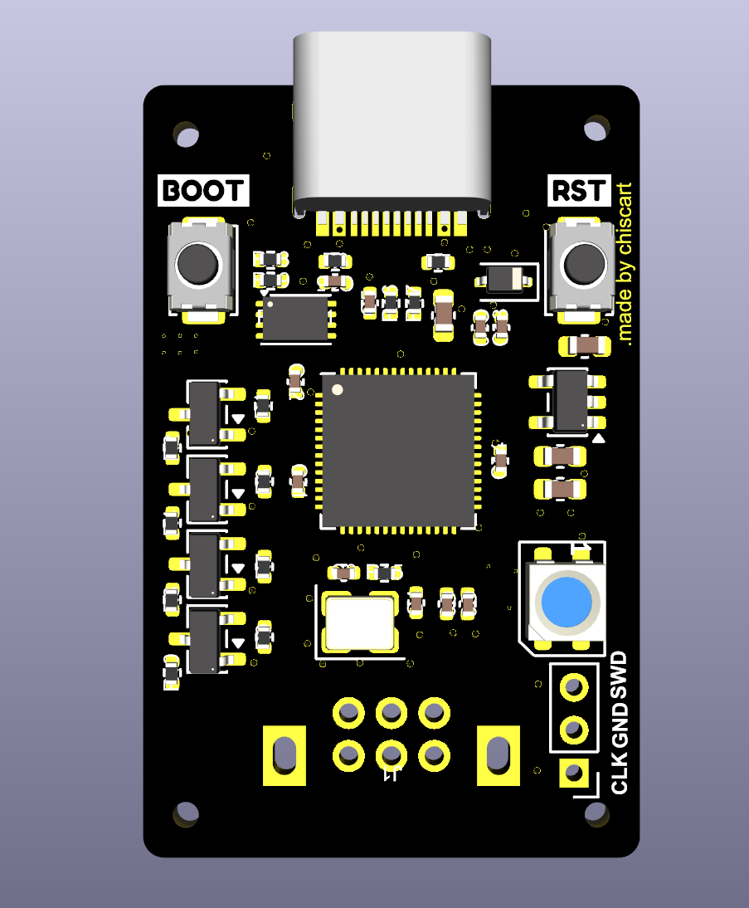
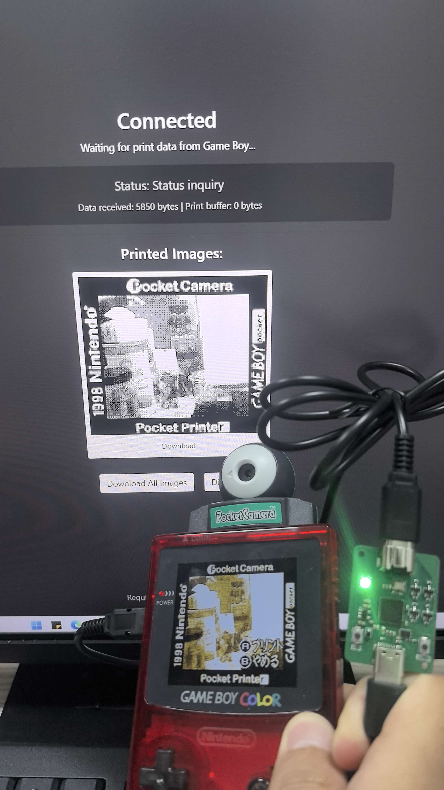
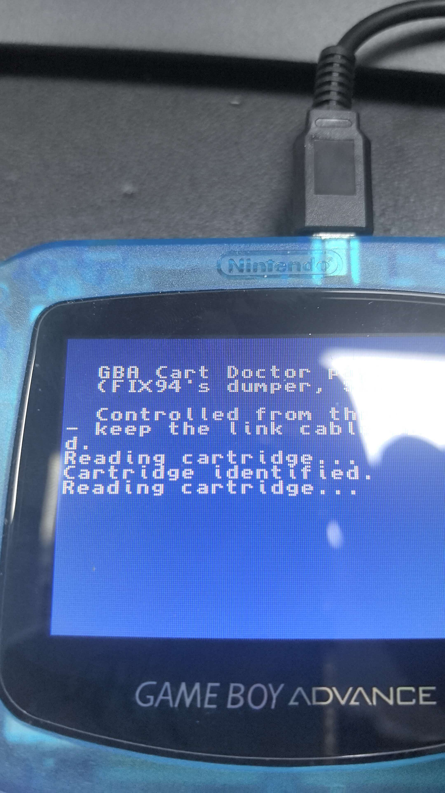
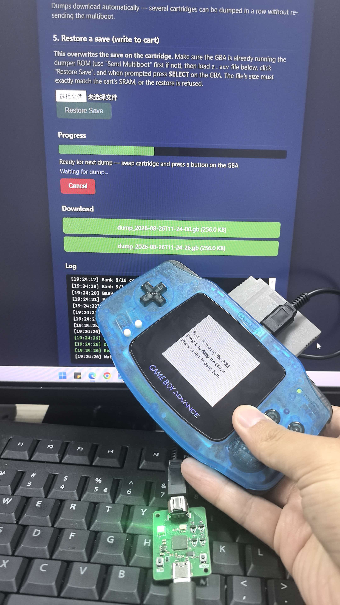

# GB-LINK-USB

**An open-source USB adapter for the Game Boy Link Cable.**



GB-LINK-USB is an RP2040-based hardware adapter that connects original Nintendo
Game Boy, Game Boy Color, and Game Boy Advance systems to a computer over USB.
Together with the open-source
[GBLink-Firmware](https://github.com/GB-Link/GBLink-Firmware), it brings modern
connectivity and community-built tools to original Game Boy hardware.

This hardware was developed with reference to the
[GB-Link-USB-DIY](https://github.com/GB-Link/GB-Link-USB-DIY) project and is
designed to be compatible with the GBLink firmware and its web-based clients.

> [!NOTE]
> GB-LINK-USB is the hardware interface. Available features depend on the
> installed firmware, client software, selected cable, game, and firmware
> version.

## What Can It Do?

With compatible firmware and client software, GB-LINK-USB can provide the
following functions:

| Mode | Description |
| --- | --- |
| **GBA online link** | Bridges two original Game Boy Advance systems over the Internet through a compatible client and server. |
| **Pokémon Gen III trade emulation** | Emulates a GBA link partner for supported Pokémon Generation III trading workflows. |
| **GB/GBC link passthrough** | Transfers Game Boy serial-link data between the console and a computer, enabling supported community clients and online play projects. |
| **Game Boy Printer emulation** | Receives images sent by compatible games so they can be viewed or saved on a computer without an original Game Boy Printer. |
| **Advance Wars link mode** | Supports communication features for *Advance Wars* and *Advance Wars 2*. |
| **Nintendo e-Reader emulation** | Emulates supported Nintendo e-Reader communication workflows. |

Depending on the frontend and firmware version, additional features such as
GBA multiboot transfers may also be available.

The firmware handles the timing-sensitive communication with the console
locally. The computer-side client can then exchange data with another adapter,
an online service, or an emulator without requiring the two consoles to be
connected by one physical Link Cable.

## Hardware Test Photos

The following photos show GB-LINK-USB working with original Game Boy hardware.

### Game Boy Printer Emulation

A Game Boy Color running *Pocket Camera* sends an image through GB-LINK-USB to
the browser-based Game Boy Printer emulator, where the received image can be
previewed and downloaded.

<p align="center">
  
</p>

### GBA Multiboot and Cartridge Communication

These tests show a cartridge utility transferred to an original Game Boy
Advance through the Link Cable interface, followed by cartridge-data transfer
between the GBA and the browser client.

| GBA multiboot utility running on original hardware | Cartridge-data transfer through the browser client |
| --- | --- |
|  |  |

## Hardware Features

- Integrated RP2040 microcontroller
- USB Type-C connection
- Game Boy Link interface
- Bidirectional level translation for console communication
- Firmware-controlled 3.3 V and 5 V interface selection
- WS2812B RGB status indicator
- BOOTSEL firmware-update support
- SWD programming and debugging connection
- Two-layer, 1.2 mm PCB
- Complete KiCad 10 design files
- Ready-to-manufacture Gerber package

## Supported Firmware

The recommended firmware is:

- [GBLink-Firmware](https://github.com/GB-Link/GBLink-Firmware)

The firmware turns the RP2040 into a USB-to-Game Boy Link Cable adapter and
provides the protocol modes used by the GB-Link web clients.

Firmware and browser tools are maintained separately from this hardware
repository. Visit the following pages for current releases and client
instructions:

- [GB-Link Launcher](https://launcher.gblink.io/)
- [GBLink-Firmware releases](https://github.com/GB-Link/GBLink-Firmware/releases)

## Quick Start

1. Manufacture and assemble the PCB using the files in this repository, or use
   an already assembled GB-LINK-USB board.
2. Install the latest GBLink firmware:
   - Use the [GB-Link Launcher](https://launcher.gblink.io/) for web-based
     flashing and updates; or
   - Download `gblink.uf2` from the
     [firmware releases](https://github.com/GB-Link/GBLink-Firmware/releases),
     hold the board's BOOTSEL button while connecting it to the computer, and
     copy the UF2 file to the RP2040 drive.
3. Connect the Game Boy system to the adapter with a compatible Link Cable.
4. Open the GB-Link Launcher, select the required mode, and follow the
   instructions for the game or client you want to use.

## Cable Compatibility

Cable construction differs between Game Boy generations and manufacturers.
According to the GBLink-Firmware documentation:

- A fully wired generic GBC Link Cable can support both GB/GBC and GBA modes.
- An original GBA Link Cable is intended for GBA modes only.
- For GBA operation, the adapter must be connected to the master side of the
  GBA cable.
- Some low-cost third-party GBA cables omit required conductors and may cause
  unreliable communication.

Always confirm the cable selection in the client before starting a link mode.

## Repository Structure

```text
.
|-- hw/
|   `-- v1.0/                    KiCad schematic, PCB, libraries, and 3D models
|-- gerber/
|   `-- GB-LINK-USB-V1.0-20260827.zip
|                                Manufacturing Gerber package
|-- extras/
|   |-- gb-link-usb-top.png      Top-side board render
|   |-- gb-link-usb-bot.png      Bottom-side board render
|   |-- gbc.jpg                  Game Boy Printer emulation test
|   |-- gba1.jpg                 GBA multiboot test
|   `-- gba2.jpg                 GBA cartridge-data transfer test
`-- README.md
```

## Manufacturing Notes

- Current hardware revision: **v1.0**
- PCB layer count: **2 layers**
- PCB thickness: **1.2 mm**
- KiCad project:
  [`hw/v1.0/GB-LINK-USB-v1.0.kicad_pro`](hw/v1.0/GB-LINK-USB-v1.0.kicad_pro)
- Gerber package:
  [`gerber/GB-LINK-USB-V1.0-20260827.zip`](gerber/GB-LINK-USB-V1.0-20260827.zip)

Before ordering assembled boards, review the schematic, PCB, component
availability, connector orientation, and fabrication outputs for the selected
manufacturer. Hardware is provided without warranty; build and use it at your
own risk.

## Acknowledgements

This project exists because many people chose to share their hardware designs,
firmware, documentation, testing, and knowledge with the community.

Special thanks to:

- The [GB-Link-USB-DIY](https://github.com/GB-Link/GB-Link-USB-DIY) project for
  the open hardware reference design and manufacturing documentation.
- [agtbaskara](https://github.com/agtbaskara/game-boy-pico-link-board), creator
  of the original Game Boy Pico link-board design.
- [fairy0715](https://github.com/fairy0715/game-boy-pico-link-board-with-gbaport)
  for the Link Port version on which later designs were based.
- The [GB-Link](https://github.com/GB-Link) maintainers and every contributor to
  [GBLink-Firmware](https://github.com/GB-Link/GBLink-Firmware).
- The [Celio-Link](https://github.com/Celio-Link/Celio-Firmware) project and its
  contributors, whose work forms an important part of the firmware's history.
- Everyone who has contributed code, hardware layouts, footprints, client
  software, documentation, issue reports, testing, and ideas to the wider
  Game Boy homebrew community.

Thank you to all of these open-source contributors. Your work keeps classic
hardware useful, accessible, and fun for a new generation of players and
developers.

## Disclaimer

This is an unofficial, community-developed open hardware project. It is not
affiliated with, endorsed by, or licensed by Nintendo, The Pokémon Company, or
any related game publisher. Game Boy, Game Boy Color, Game Boy Advance, Pokémon,
and other product names are trademarks of their respective owners.
